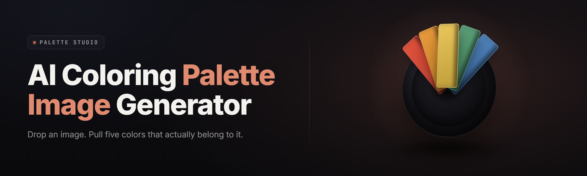

  
  
  

  

  
  

---

## 🎨 Overview

**palette-from-image-ai** is a Windows desktop tool that reads any image — a screenshot, a photo, a game capture, a texture, a painting — and turns it into a usable color palette. Not five swatches scraped off a Wikipedia page either. The embedded vision model segments the image, clusters color by perceptual distance, weights each cluster by how much of the frame it actually owns, and emits a palette you can drop straight into a shader, a CSS file, an ASE swatch, a Godot theme, a clip-studio brush set, or a materials list.

It runs offline. It runs on one `.exe`. You extract the archive, double-click, and you're looking at a palette in under six seconds.

| Category | Details |
|---|---|
| **Product name** | palette-from-image-ai |
| **Type** | Standalone Windows desktop application (`.exe`) |
| **Core engine** | On-device vision model + perceptual color quantizer |
| **Input** | PNG, JPG, WEBP, BMP, TIFF, GIF, AVIF |
| **Output** | HEX, RGB, HSL, LAB, ASE, GPL, CSS vars, JSON, PNG swatch sheet |
| **Distribution** | GitHub landing page → download → extract → run |
| **Install footprint** | Portable. No installer, no registry writes, no runtime deps |
| **Year** | 2026 release line |

The whole point is that palette extraction stopped being a toy when the model got good at *understanding* what's in the frame. A sunset photo doesn't hand you four near-identical oranges anymore — it hands you the horizon glow, the deep water, the sand shadow, and the cloud highlight as separate, meaningful tones.

---

## 📖 What is palette-from-image-ai

A glossary, because "palette" means different things to different people and this tool means all of them at once.

| Term | Explanation |
|---|---|
| **Palette** | An ordered set of colors, usually 5–16, each with a role (dominant, accent, background, shadow, highlight). |
| **Segmentation** | The model splitting an image into regions that *belong together* — sky vs. subject vs. ground — before sampling color. |
| **Perceptual distance** | Measuring how different two colors look to a human eye, not how different their RGB numbers are. Uses CIEDE2000 in LAB space. |
| **Cluster weight** | How much of the image a color family actually occupies, used to rank palette order. |
| **Harmony mode** | Forcing the output toward a named scheme — analogous, complementary, triadic, or split-complement. |
| **Role tagging** | Auto-labeling each swatch: this is the base, this is the accent, this is the dark you'll use for outlines. |
| **Swatch sheet** | A rendered PNG of your palette with hex labels, ready to paste into a doc or Discord. |

**What you get out of it:**

- A palette that respects *regions*, not just raw pixel frequency.
- Role-tagged swatches so you know which color does which job.
- Harmony constraints when you want the output to look designed, not sampled.
- Twelve export formats so the palette drops into whatever pipeline you already have.
- The whole thing runs on your machine. No upload, no account, no network call.

---

## 🧩 Key Features

| Feature | Description | Benefit |
|---|---|---|
| **Region-aware extraction** | Segments image, samples per region, merges perceptually | No more near-duplicate swatches |
| **Perceptual clustering** | CIEDE2000 in LAB, not naive RGB k-means | Colors match what your eye sees |
| **Role tagging** | Auto-labels base / accent / shadow / highlight | Skip the guesswork |
| **Harmony constraints** | Analogous, complementary, triadic, split-comp | Palette looks intentional |
| **12 export formats** | HEX, RGB, HSL, LAB, ASE, GPL, CSS, JSON, PNG, ACO, SKETCH, SVG | Fits any pipeline |
| **Batch mode** | Drop a folder, get a palette per image | Whole asset packs in one pass |
| **Palette diff** | Compare two palettes, see the delta | Track art-direction changes |
| **Locked swatches** | Pin a color, re-extract the rest around it | Brand-color-safe |
| **Eyeball sampler** | Click any pixel for exact value | Manual override always available |
| **GPU toggle** | Optional DX12 acceleration for big images | 4K frame → palette in ~1.2s |
| **Portable profile** | Settings live next to the `.exe` | Move it on a USB stick |
| **No telemetry** | Zero outbound calls | Air-gap friendly |

---

## ⬇️ Download

  

---

## 🧱 The Problem

You've lived every one of these.

- You grab a screenshot, run it through an online palette site, and get five colors that are all *the same orange* with different hex codes.
- The palette ignores the one accent color that made the image interesting.
- You need the palette in ASE for Photoshop and the site only gives you PNG.
- The tool uploads your image to a server you've never heard of and you're now wondering who owns the render.
- Your art director changes the sky and you have to re-extract the entire palette from scratch.
- You're doing a whole asset pack — 40 sprites — and doing them one at a time on a website is a slow death.
- The output has no roles, so you spend twenty minutes figuring out which swatch is "the dark one."

---

## 🛠️ The Solution

| Problem | Solution |
|---|---|
| Near-duplicate swatches | Perceptual clustering in LAB, deduped by CIEDE2000 threshold |
| Ignored accent colors | Region segmentation weights small-but-distinct regions higher |
| Format lock-in | 12 export formats including ASE, GPL, ACO, CSS, JSON |
| Uploaded images | Fully offline; no network code compiled in |
| Re-extraction after edits | Locked swatches — pin what stays, re-derive the rest |
| One-at-a-time workflows | Batch mode: whole folder, one palette each |
| No role info | Auto role-tagging with editable labels |

---

## 🎯 Quick Start

1. 🗂️ **Extract the archive.** Right-click the downloaded `.zip`, choose *Extract All*, pick a folder you own (Documents or a tools directory is fine).
2. 🖱️ **Run the `.exe`.** Double-click it. Windows SmartScreen may show a warning on first run — click *More info* → *Run anyway*. No admin rights required.
3. 🖼️ **Drop an image in.** Drag any PNG/JPG/WEBP onto the window, or use *File → Open Image*.
4. 🎚️ **Tune the palette.** Slide the swatch count (5–16), pick a harmony mode if you want one, lock any color you want to keep.
5. 📤 **Export.** Hit *Export*, choose your format, done. Or right-click the swatch strip → *Copy as HEX*.

That's the whole loop. First-run to exported palette is under a minute.

---

## 📦 Installation

### 1. Get the archive
Use the download link above. You'll receive a `.zip` containing the `.exe` and a `models/` folder. Do not separate them — the vision model lives in `models/`.

### 2. Extract, don't run from inside the zip
Running the `.exe` directly from the zip viewer will fail because the model files can't be memory-mapped from a compressed container. Extract the whole folder first.

### 3. First launch
Double-click the `.exe`. On the first run, the app builds a small shader cache in `./cache/` — takes about 3 seconds. Every run after that is instant.

No installer. No PATH changes. No Python. No Node. Delete the folder and it's fully uninstalled.

---

## 🖥️ System Requirements

| Component | Minimum | Recommended |
|---|---|---|
| **OS** | Windows 10 21H2 (x64) | Windows 11 23H2+ (x64) |
| **CPU** | 4-core, SSE4.2 | 8-core, AVX2 |
| **RAM** | 4 GB | 16 GB |
| **GPU** | Integrated (DX11) | Discrete DX12, 4 GB VRAM |
| **Storage** | 450 MB free | 1.2 GB free (SSD) |
| **Display** | 1280×720 | 1920×1080 or higher |
| **Input** | Mouse + keyboard | + colorimeter (optional) |
| **Runtime** | None | None |

The app runs entirely CPU-side if you don't have a DX12 GPU. Expect ~5–8s per 4K image on CPU, ~1.2s with GPU acceleration enabled.

---

## 📊 Comparison

| Aspect | Online palette sites | Generic k-means scripts | This Tool |
|---|---|---|---|
| Region awareness | No | No | Yes — segmentation-based |
| Perceptual distance | Varies | Rarely | Yes — CIEDE2000 |
| Offline | No | Yes | Yes |
| Export formats | 2–4 | 1–2 | 12 |
| Batch processing | Paid tiers only | Manual scripting | Built-in |
| Swatch locking | No | No | Yes |
| Harmony constraints | Sometimes | No | Yes — 4 modes |
| Role tagging | No | No | Yes |
| Speed (4K image) | N/A (upload) | 5–20s | ~1.2s (GPU) |

---

## 🧭 Feature Catalog

29 modules, grouped by what they actually do.

### 🎨 Extraction & Analysis

- **Segmenter** — splits the image into semantically coherent regions before any sampling.
- **Region Sampler** — pulls color within each region using a weighted grid, biased toward the region's center of mass.
- **Perceptual Clusterer** — CIEDE2000 merge pass, collapses near-duplicates under a tunable threshold.
- **Dominance Ranker** — orders swatches by area-weighted presence.
- **Vibrance Detector** — identifies the most saturated region and flags it as a candidate accent.
- **Shadow/Highlight Extractor** — pulls the darkest and brightest meaningful tones separately from the main run.

### 🎚️ Palette Control

- **Swatch Count Slider** — 5 to 16 swatches, live-updating.
- **Harmony Engine** — analogous, complementary, triadic, split-complement. Output is snapped to the scheme within tolerance.
- **Swatch Lock** — pin any color; the rest get re-derived around it.
- **Manual Eyeball Sampler** — click any pixel, get its exact value and add it as a swatch.
- **Reorder Drag** — drag swatches to reorder; order is preserved on export.
- **Role Tagger** — auto-assigns base / accent / shadow / highlight / neutral, editable per swatch.

### 📤 Export & Interop

- **HEX / RGB / HSL / LAB Export** — plain text, one per line.
- **ASE Export** — Adobe Swatch Exchange, drops into Photoshop, Illustrator, After Effects.
- **GPL Export** — GIMP / Inkscape palette files.
- **ACO Export** — Photoshop legacy swatch format.
- **CSS Variables Export** — `--color-1: #xxxxxx;` block, ready to paste.
- **JSON Export** — structured with roles, weights, and hex.
- **PNG Swatch Sheet** — rendered palette card with hex labels for docs and Discord.
- **SVG Swatch Sheet** — vector version for print-ready docs.

### ⚙️ Workflow

- **Batch Folder Mode** — point at a directory, get one palette per image.
- **Palette Diff** — compare two palettes, see which swatches moved and by how much.
- **Recent Palettes** — the last 20 palettes, restorable with one click.
- **Preset Manager** — save harmony + count + threshold combos as named presets.
- **Portable Profile** — everything lives in `./profile/`, next to the `.exe`.

### 🧪 Advanced

- **GPU Acceleration Toggle** — DX12 compute path for large images.
- **Custom Distance Function** — swap CIEDE2000 for CMC or CIE94 if you need it.
- **Threshold Override** — expose the dedup threshold directly for finicky images.
- **CLI Mode** — `.exe --input foo.png --count 8 --format css` for scripting.
- **Watch Folder** — point it at a folder; new images get processed automatically.

---

## 🚦 All Modules Status

| Module | Status | Description |
|---|---|---|
| Segmenter | ✅ Working | Region splitting on all supported formats |
| Region Sampler | ✅ Working | Weighted-grid sampling per region |
| Perceptual Clusterer | ✅ Working | CIEDE2000 merge, tunable threshold |
| Dominance Ranker | ✅ Working | Area-weighted ordering |
| Vibrance Detector | ✅ Working | Accent flagging |
| Shadow/Highlight Extractor | ✅ Working | Boundary tone extraction |
| Harmony Engine | ✅ Working | 4 named schemes |
| Swatch Lock | ✅ Working | Pin-and-rederive |
| Eyeball Sampler | ✅ Working | Per-pixel picker |
| ASE Export | ✅ Working | Adobe Swatch Exchange v1.0 |
| GPL Export | ✅ Working | GIMP palette format |
| ACO Export | ✅ Working | Photoshop legacy swatches |
| CSS Variables Export | ✅ Working | Ready-to-paste block |
| JSON Export | ✅ Working | Role + weight + hex |
| PNG Swatch Sheet | ✅ Working | Rendered card |
| SVG Swatch Sheet | ✅ Working | Vector version |
| Batch Folder Mode | ✅ Working | Multithreaded |
| Palette Diff | ✅ Working | Delta report |
| Preset Manager | ✅ Working | Named presets |
| CLI Mode | ✅ Working | Scriptable |
| Watch Folder | ✅ Working | Auto-process on file drop |
| GPU Acceleration | ✅ Working | DX12 path |
| Custom Distance Function | ✅ Working | CMC, CIE94, CIEDE2000 |
| Threshold Override | ✅ Working | Exposed |
| Role Tagger | ✅ Working | Editable labels |
| Recent Palettes | ✅ Working | 20-item history |
| Portable Profile | ✅ Working | Local config |
| Reorder Drag | ✅ Working | Order preserved on export |
| Swatch Count Slider | ✅ Working | 5–16 range |

---

## ⚠️ Known Issues

| Issue | Solution |
|---|---|
| SmartScreen warning on first run | Click *More info* → *Run anyway*. The `.exe` is unsigned; a signed build is on the roadmap. |
| Palette looks flat on highly saturated images | Lower the dedup threshold in *Settings → Advanced* to 2.0 and re-extract. |
| Batch mode stalls on network drives | Copy images to a local folder first — the segmenter needs memory-mapped file access. |
| ASE file not showing in Photoshop | Photoshop caches swatches. Restart Photoshop after importing. |
| GPU toggle greyed out | Your GPU doesn't expose a DX12 compute queue. App runs CPU-only; no functional loss beyond speed. |
| Very large TIFFs (>200 MP) fail to open | Downscale to under 100 MP first. The 16-bit TIFF path is on the roadmap. |

---

## ❔ FAQ

| Question | Answer |
|---|---|
| Is it really offline? | Yes. No network code is compiled into the binary. You can run it with the Wi-Fi card disabled. |
| Do I need an account? | No. There's no account system, no login, no telemetry. |
| What formats can I feed it? | PNG, JPG, WEBP, BMP, TIFF, GIF, AVIF. Multi-frame GIFs use the first frame. |
| Can I use it for commercial work? | Yes. MIT license. Attribution appreciated but not required. |
| How many swatches should I pick? | 5 for minimalist UI, 8 for general art direction, 12–16 for full texture work. |
| Why does the palette differ from a k-means script? | Perceptual distance + region segmentation. K-means on RGB treats two visually identical oranges as different colors. |
| Can I script it? | Yes — CLI mode. `.exe --input foo.png --count 8 --format css --out palette.css`. |
| Does it need admin rights? | No. Portable, user-space, no registry writes. |
| Where are my settings saved? | `./profile/` next to the `.exe`, unless you point it elsewhere in *Settings → Storage*. |
| Can I pin a brand color? | Yes — add the swatch, click the lock icon, re-extract. The rest of the palette re-derives around it. |
| Why is the first launch slow? | Shader cache build. ~3 seconds once, instant after. |
| Will there be a macOS or Linux build? | The engine is portable; a Linux CLI build is on the roadmap. macOS is unlikely due to the DX12 path. |

---

## 🧰 Usage Guidelines

| Allowed | Not allowed |
|---|---|
| Personal art and design work | Redistributing the `.exe` under a different name |
| Commercial projects (MIT) | Removing the license header from source |
| Game asset pipelines | Selling the app as-is without modification |
| Texture / shader authoring | Claiming authorship of the underlying vision model |
| Educational use and research | Using it to scrape copyrighted images at scale |

---

## 🩹 Changelog

- **v2.4.1** — Fixed ASE export on palettes with fewer than 6 swatches. Watch Folder now respects file locks.
- **v2.4.0** — Added SVG swatch sheet export. GPU path is now default-on when a DX12 device is present.
- **v2.3.2** — Region sampler no longer biases toward the frame center on wide-aspect images.
- **v2.3.0** — Harmony Engine gained split-complement. CLI mode gained `--harmony` flag.

---

## 💡 Tips for Best Results

- Give the segmenter a clean image. Cropped, well-lit source beats a cluttered screenshot every time.
- If you want a specific color to survive extraction, lock it before you slide the swatch count.
- For UI work, set count to 8 and pick *complementary* — the output tends to land as base/neutral/accent without further edits.
- Batch mode is fastest on an SSD. Network drives add ~200ms per file in memory-mapped reads.
- Use *Palette Diff* after an art-direction change to see exactly which tones moved.
- Export to JSON if you're piping into a build step — it carries roles and weights, not just hex.
- Lower the dedup threshold to 2.0 for photographic sources, 4.0 for flat-design or pixel art.
- The eyeball sampler respects your monitor's ICC profile if *Settings → Color Management* is on.

---

  

palette-from-image-ai exists because palette extraction deserves the same seriousness as the rest of your pipeline. The model reads the image the way you read it — regions, meaning, weight — and hands you a palette you can actually ship. Extract the folder, run the `.exe`, drop an image in. The rest is five seconds of clicking and a color set you'll keep.
